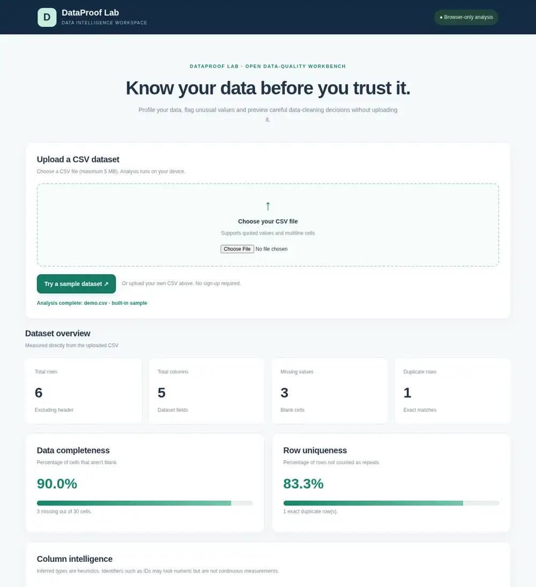

# DataProof Lab · Dataset Quality Studio

**A privacy-conscious, browser-only data-quality explorer with statistical profiling, non-destructive cleaning previews, and an explainable Dataset Passport.**

**Current version:** v1.0.0 portfolio release (November 2026). Built with HTML, CSS and vanilla JavaScript. No account, MySQL, server process, external API or trained ML model.



[Mobile screenshot](assets/dataproof-dashboard-mobile.webp) · [Detailed Dataset Passport screenshot](assets/dataproof-passport-section.webp)

## Upcoming advanced platform: DataProof X

An experimental **Custom Validation Studio** has been implemented on the
[\`feature/validation-studio-v2\`](https://github.com/Bhumi1107/DataProof-lab/tree/feature/validation-studio-v2)
branch. It lets users configure required, unique, numeric-range and allowed-value
checks for the original CSV, inspect failure counts and CSV row references,
and export an aggregate rule summary. The stable live v1.0 website is unchanged
until this feature branch is reviewed and merged.

The broader roadmap covers decision-aware cleaning, two-dataset drift detection,
ML readiness checks and eventually actual evaluated baseline ML models.
**These later capabilities are plans, not features already available.**

See [DataProof X roadmap](docs/ADVANCED_ROADMAP.md).

## Quick start

1. Extract the ZIP **fully** to an ordinary folder such as `Documents/DataProof-Lab` (do not run `index.html` inside a compressed ZIP or temporary archive preview).
2. Open `index.html` in Edge or Chrome. Keep the `.js` and `.css` files alongside it.
3. Click **Try a sample dataset** to explore it instantly, or upload `demo.csv` (or another well-formed CSV up to 5 MB).
4. Explore the overview, distributions and **Data Cleaning Studio**.
5. Scroll to **Dataset Passport** and switch between **Original uploaded data** and **Simulated cleaning preview**.
6. Click **Download JSON report** or **Download printable HTML**. Open the HTML report in a browser; use your browser's Print command to save it as PDF if desired.

The `examples/` folder contains aggregate-only Passport reports from the fictional sample, and `assets/` contains real desktop and mobile browser screenshots. An immediate Try Sample flow means visitors can explore the live site without first downloading a CSV.

The original CSV remains unchanged. The application does not send data to a server or store rows in localStorage. **Avoid uploading confidential or personal data**: browser and downloaded aggregate reports are not a secure healthcare, finance, or enterprise solution.

## Live site

After the GitHub repository is created and Pages is enabled, the expected URL is **https://bhumi1107.github.io/DataProof-lab/**. It is **not live or verified yet**. Publishing steps: [docs/PUBLISHING.md](docs/PUBLISHING.md).

## Features

| Area | Current functionality |
| --- | --- |
| CSV upload | Handles quoted commas, escaped quotes and multiline values; validates header uniqueness and rectangular rows |
| Structural audit | Rows, columns, missing cells, exact duplicate rows, completeness, uniqueness |
| Statistical profile | Heuristic column types, distinct counts, mean, median, min, max, quartiles, IQR |
| Outlier review | 1.5 × IQR rule; numeric columns only, with minimum sample/variation checks |
| Visualization | Browser-rendered numeric histogram or value-frequency bars |
| Cleaning Studio | Preview exact duplicate removal and single-column median/mode imputation |
| Dataset Passport | Transparent findings, severity, evidence, next steps, aggregate column summaries |
| Report variants | Compare original dataset against the current simulated cleaning preview |
| Report export | Download JSON or **printable, standalone HTML** containing no individual CSV rows |
| Tests | 21 Node standard-library tests, GitHub Actions quality checks, desktop and mobile browser smoke checks |

## Example: demo.csv

Original: **6 rows, 5 columns, 3 blank cells, 1 duplicate, 90% completeness.**

Cleaning preview (duplicate removal + missing `score` median): **5 rows, 2 blank cells, 0 duplicates, 92% completeness.** The missing score is imputed to **73.5**. The original dataset is not modified. A score of 98 may be identified as a possible IQR outlier; a flag is not proof that a value is wrong.

The Passport's *review/high* count is the number of **rule-level findings**, not the number of individual bad rows or a machine-learning quality score.

## Files

- `index.html` — website structure and Dataset Passport controls.
- `style.css` — responsive UI and report section styling.
- `parser.js` — CSV parser.
- `audit.js` — completeness and exact duplicates.
- `statistics.js` — type inference, quartiles, numeric summaries.
- `app.js` — CSV loading, data preview, charts.
- `cleaning.js` — non-destructive cleaning simulation, CSV export.
- `passport.js` — aggregate-only report calculations, findings, JSON / printable HTML export.
- `demo.csv` — fictional test dataset.
- `tests/` — Node tests for cleaning and passports.
- `TESTING.md` and `CHANGELOG.md` — evidence and development notes.
- `docs/ARCHITECTURE.md` — design, data flow, formulas, tradeoffs and privacy caveats.
- `docs/CASE_STUDY.md` — a portfolio explanation without exaggerated authorship claims.
- `docs/PUBLISHING.md` — exact GitHub + GitHub Pages instructions for the owner.
- `.github/workflows/quality-checks.yml` — automatic Node tests on pushes and pull requests.

## Run tests (optional for a portfolio developer)

Requires **Node.js 20+**, no `npm install`:

```sh
npm test
# or: node --test tests/*.test.js
```

For JavaScript syntax checks **and** tests: `npm run check`. No package installation is required.

## Design decisions and limitations

- **No opaque quality score:** the Passport presents measured metrics and rule-based findings. It is not a guarantee of model readiness or a trained AI model.
- **Possible outliers:** the 1.5 × IQR rule is not used on identifier-like columns in the Passport warnings. Outliers may be legitimate.
- **Missing data:** empty strings and whitespace-only cells count as missing. Exact duplicate detection uses string equality.
- **Column types:** heuristic inference. Numeric IDs may look like measurements; dates and mixed formats may be misclassified.
- **Only one imputation column at a time:** cleaning removes duplicates first, then fills one eligible column. Imputation is a statistical estimate, not an observed value.
- **Passport privacy:** downloads intentionally exclude individual CSV records, but column names, filenames and summary statistics **can still be sensitive**. Inspect before sharing.
- **CSV exports:** spreadsheet-formula-like text in the cleaned CSV may be prefixed with `'` for safer opening in spreadsheet software. The preview contains the original values.
- **Not assessed:** target leakage, sampling bias, provenance, fairness, model performance, domain-specific validity, secure access controls.
- **5 MB cap:** large and high-dimensional files may be slow because processing occurs on one browser thread.

## Meaningful follow-up work (not yet implemented)

- [ ] Extract parser and statistics into modules with more edge-case and property tests.
- [ ] Add explicit target-column selection and leakage heuristics (with robust caveats).
- [ ] Create comparison views for different datasets or dataset revisions.
- [ ] Add an accessible keyboard-first tour and more screen-reader audits.
- [ ] Write a project case study documenting why features were added, which bugs occurred, and how they were fixed.

### GitHub portfolio workflow

Follow [docs/PUBLISHING.md](docs/PUBLISHING.md) to create the public `DataProof-lab` repository, push all source files with Git, enable GitHub Pages, and verify the live site. Make genuine commits as you personally test, refine or implement new features. Avoid fabricated dates or artificial commits. The history should document real engineering decisions rather than try to prove a certain number of hours.

**Ownership note:** A portfolio should reflect what you personally understand and can demonstrate. Read the source, reproduce the tests, and note the role of any coding assistance honestly. You cannot infer hours worked or original authorship from commit counts alone.

This is an **educational frontend data-analysis tool**, not a production data governance solution.
